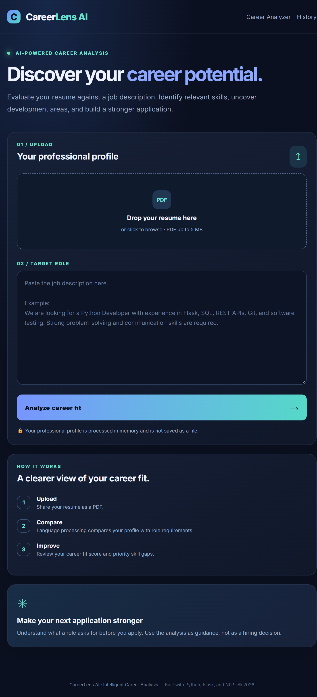
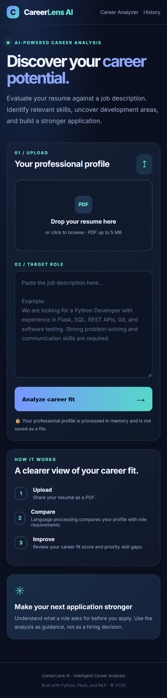
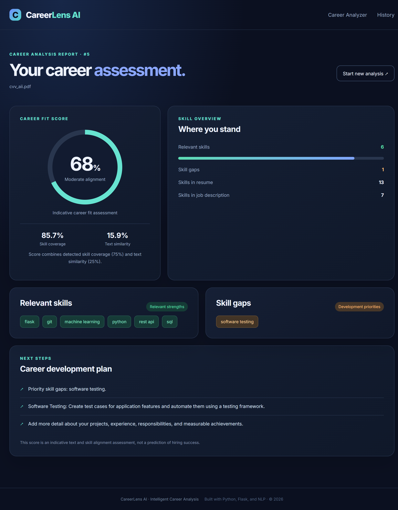
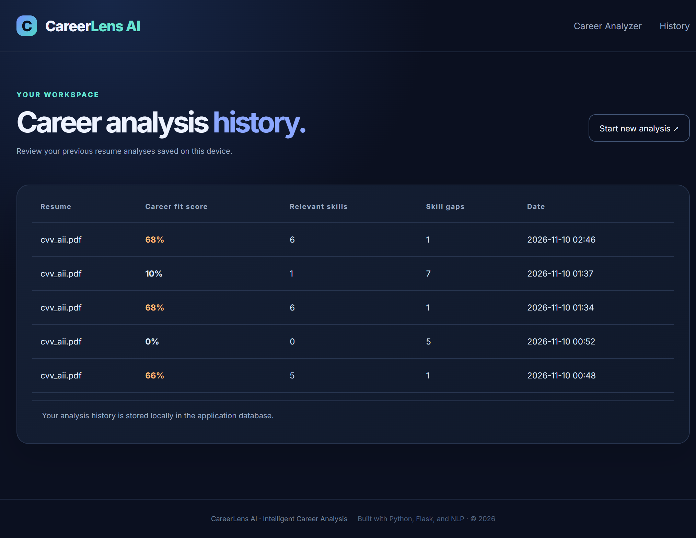

# CareerLens AI
### Intelligent Resume & Career Analysis Platform

CareerLens AI is a web-based application that analyzes PDF resumes against job descriptions using Natural Language Processing (NLP).

It identifies relevant skills, highlights skill gaps, calculates an indicative Career Fit Score, and provides actionable recommendations to help candidates improve their career readiness.

## Features

- **Resume Parsing:** Extracts text from PDF resumes securely in memory.
- **Skill Extraction:** Identifies technical and professional skills from resumes and job descriptions.
- **NLP Analysis:** Uses TF-IDF and Cosine Similarity to measure textual alignment.
- **Career Fit Score:** Combines skill coverage and text similarity into a weighted score.
- **Skill Gap Analysis:** Highlights missing skills relevant to a target role.
- **Development Recommendations:** Provides practical learning suggestions based on identified skill gaps.
- **Analysis History:** Stores summary results locally using SQLite.
- **Automated Testing:** Includes tests using Pytest.

## Screenshots

Add screenshots of the application here:

- Home Page
- Career Analysis Report
- Skill Gap Analysis
- Analysis History

## Technology Stack

| Category | Technology |
|---|---|
| Programming Language | Python 3.11 |
| Web Framework | Flask |
| PDF Processing | PyMuPDF |
| NLP & Similarity | Scikit-learn |
| Database | SQLite |
| Frontend | HTML, CSS, JavaScript |
| Testing | Pytest |

## Project Structure

```text
CareerLensAI/
│
├── analyzer/
│   ├── resume_parser.py
│   ├── skills_extractor.py
│   ├── job_analyzer.py
│   └── matching_engine.py
│
├── database/
│   └── db.py
│
├── static/
│   └── style.css
│
├── templates/
│   ├── base.html
│   ├── index.html
│   ├── results.html
│   └── history.html
│
├── tests/
│
├── uploads/
├── app.py
├── requirements.txt
├── README.md
└── .gitignore
```

## Installation & Setup

### Requirements

- Python 3.11 or later
- Git

### Run on Windows

1. Clone the repository:

```powershell
git clone YOUR_GITHUB_REPOSITORY_URL
cd CareerLensAI
```

2. Create a virtual environment:

```powershell
py -3.11 -m venv venv
```

3. Activate the environment:

```powershell
Set-ExecutionPolicy -Scope Process -ExecutionPolicy Bypass
.\venv\Scripts\Activate.ps1
```

4. Install dependencies:

```powershell
pip install -r requirements.txt
```

5. Start the application:

```powershell
python app.py
```

6. Open your browser:

http://127.0.0.1:5000

## Run Automated Tests

```powershell
pytest
```

## Career Fit Score Methodology

The Career Fit Score combines two measurements:

- **75% Skill Coverage:** The percentage of job-related skills detected in the resume.
- **25% Text Similarity:** TF-IDF and Cosine Similarity between the resume text and job description.

The score is intended as an indicative alignment measure, not a prediction of hiring success.

Skill extraction uses a predefined vocabulary and aliases. It may not identify every skill, synonym, or contextual reference.

## Privacy & Limitations

- Resume PDFs are processed in memory and are not saved as uploaded files.
- Analysis history stores filenames and summary metrics, not resume contents.
- Supports text-based PDF files; scanned image-only PDFs are not currently supported.
- Skill detection depends on the supported vocabulary.
- Results provide decision-support guidance and should not be used as automated hiring decisions.

## Future Improvements

- Expand skill recognition and synonym support.
- Improve semantic understanding of job descriptions.
- Add detailed analysis reports and export options.
- Support additional resume formats.
- Improve multilingual resume analysis.

## Author

Developed as a portfolio project to demonstrate skills in Python, Flask, NLP, PDF processing, database integration, and web application development.
## Screenshots

### Desktop Homepage


### Mobile Homepage


### Analysis Results


### Analysis History

